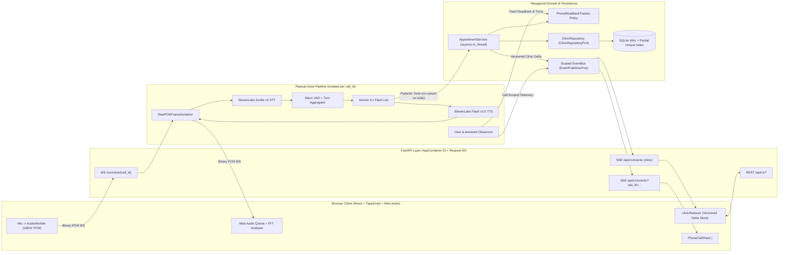
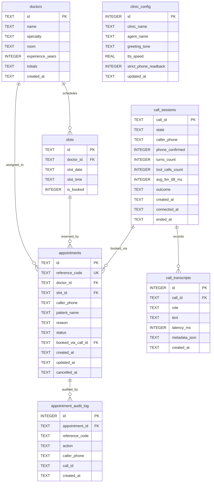

# System Architecture — Aurelia Health Voice Desk

This document details the application architecture, relational schema design, deterministic business-rule enforcement, and real-time voice data flow.

---

## 1. End-to-End Architecture & Data Flow



---

## 2. Relational Data Model & Schema Invariants

Managed via versioned idempotent migrations in `schema_migrations` (`001_core_clinic_schema`, `002_appointment_audit_log`, `003_fde_transcripts_and_config`) with SQLite `WAL` mode, `foreign_keys = ON`, and `busy_timeout = 5000ms`:



### Database-Engine-Level Invariants
1. **Partial Unique Index (`uq_active_appointment_per_slot`)**:
   ```sql
   CREATE UNIQUE INDEX uq_active_appointment_per_slot
       ON appointments (slot_id)
       WHERE status = 'confirmed';
   ```
   Guarantees at the database engine level that a slot can keep full cancellation history while permitting **at most one active confirmed appointment**.
2. **State-Consistency `CHECK` Constraint**:
   ```sql
   CHECK (
       (status = 'confirmed' AND cancelled_at IS NULL)
       OR (status = 'cancelled' AND cancelled_at IS NOT NULL)
   )
   ```
   Prevents inconsistent status/timestamp states even outside the application layer.
3. **Immutable `appointment_audit_log`**: Every booking and cancellation atomically inserts an audit record in the same `BEGIN IMMEDIATE` transaction.
4. **Rolling Schedule Self-Healing**: On startup, `DatabaseManager` idempotently ensures every physician has slots for `today` and `tomorrow` without disturbing existing bookings.

---

## 3. Business Rules & Domain Policies

| Rule | Where Enforced | Behavior |
| :--- | :--- | :--- |
| **Phone-Only Identity** | `PhoneNumber` (`domain/value_objects.py`) | Strips formatting & `+91`/`+1` prefixes, converts spoken digit words (`"double nine"`), validates 7–15 digits. Zero login/OTP/caller-ID. |
| **Mandatory Read-Back Confirmation** | `PhoneReadbackTracker` (`domain/policies.py`) + `UserSpeechObserver` / `AssistantSpeechObserver` | State machine proves Maya actually spoke the caller's digits back in an assistant turn **and** heard a subsequent caller turn before `book_appointment` or `cancel_appointment` can execute — blocking eager LLM tool calls even if the LLM passes `phone_confirmed_by_caller=true`. |
| **Atomic Slot Reservation** | `ClinicRepository.book_slot_atomic` | Serialized `BEGIN IMMEDIATE` + conditional `UPDATE slots SET is_booked = 1 WHERE id = ? AND is_booked = 0` (`rowcount == 1`). Concurrent calls cannot double-book. |
| **No Overlapping Caller Bookings** | `ClinicRepository.book_slot_atomic` | Rejects (`OverlappingAppointmentError`, HTTP 409) if the same caller already has a confirmed appointment at the exact same `(slot_date, slot_time)`. |
| **Ambiguous Cancellation Disambiguation** | `ClinicRepository.cancel_appointment_atomic` | If a caller holds 2+ active appointments and doesn't name a doctor or reference code, raises `AmbiguousCancellationError` listing their active bookings so Maya asks which one to cancel. |
| **Interruption-Safe Write Tools** | `ClinicToolDispatcher` (`voice/tools.py`) | `book_appointment` and `cancel_appointment` register with `cancel_on_interruption=False` and `timeout_secs=10.0` so a cough or brief acknowledgment never aborts an in-flight DB write. |

---

## 4. Real-Time Voice Latency & Frontend Sync

- **Voice Latency**:
  - `GoogleLLMService` defaults to `gemini-3.1-flash-lite` (sub-second voice responses on Google AI Studio free tier; supports `GEMINI_USE_VERTEX=true` for Vertex AI Express Mode and automatically sets `thinking_budget=0` when configured with Gemini 2.5 models).
  - `ElevenLabsRealtimeSTTService` (`scribe_v2_realtime`) pairs `CommitStrategy.MANUAL` with Pipecat's **Silero VAD** and passes physician names + specialties as `keyterms` (with `ELEVENLABS_STT_MODE=segmented` HTTP fallback).
  - `ElevenLabsTTSService` runs `eleven_flash_v2_5` (~75 ms latency) with premade free-tier voice Sarah (`EXAVITQu4vr4xnSDxMaL`) and `apply_text_normalization="on"`.
  - `AssistantSpeechObserver` flushes partial text buffers cleanly on `InterruptionFrame` so barge-in never merges two turns.
- **Session Isolation & Delta Sync**:
  - `POST /api/v1/calls` provisions an isolated `call_id` persisted in `call_sessions`.
  - Call telemetry streams exclusively over `/api/v1/events?call_id=<id>`; clinic domain updates broadcast over `/api/v1/events` with monotonic `version` integers.
  - Frontend `clinicReducer` applies slot & appointment deltas directly without redundant polling and automatically resyncs `/api/v1/clinic/snapshot` on sequence gaps.
